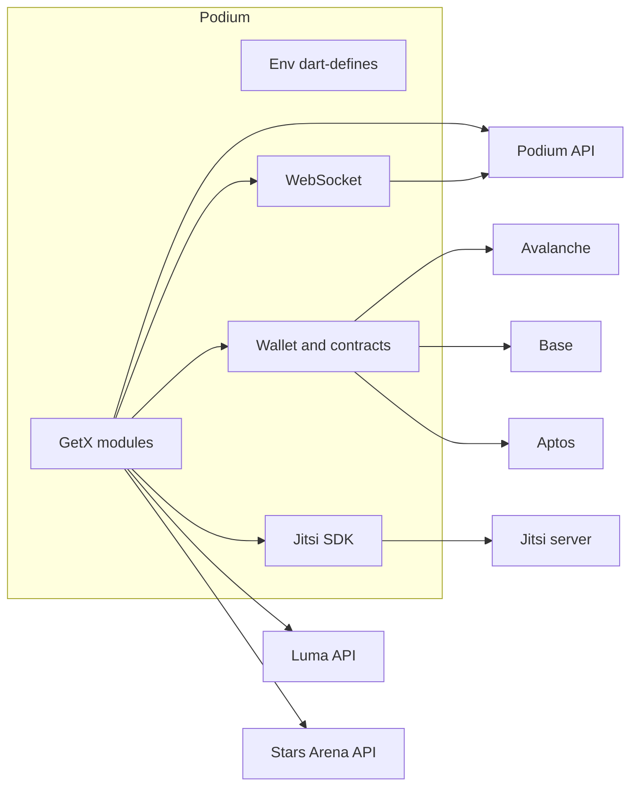

<p align="center">
  
</p>

<h1 align="center">Podium</h1>

<p align="center">
  Live audio and video rooms for web3 communities.<br />
  A Flutter app for iOS and Android.
</p>

<p align="center">
  
  
  
  
</p>

An **outpost** is a scheduled or live room. People join with a social login or a wallet, talk over [Jitsi](https://jitsi.org/), and can gate entry or the mic with on-chain passes. The interface is a dark navy canvas with drifting cyan, violet, and magenta light. That look is documented in [`docs/design-system.md`](docs/design-system.md).

---

## Contents

- [What you can do](#what-you-can-do)
- [Stack](#stack)
- [Architecture](#architecture)
- [Repository layout](#repository-layout)
- [Requirements](#requirements)
- [First run](#first-run)
- [Environment](#environment)
- [Run](#run)
- [Build](#build)
- [Code generation](#code-generation)
- [Tests](#tests)
- [Scripts](#scripts)
- [Troubleshooting](#troubleshooting)

---

## What you can do

| | |
| --- | --- |
| **Rooms** | Browse live and upcoming outposts, search, open a detail page, and join. A floating bubble keeps the call reachable while you move around the app. |
| **Live call** | Mic, reactions, raised hands, chat, screen share, polls, invite links, mute-all, and a local recording you can trim afterward. |
| **Access** | Public rooms, link-only rooms, invite lists, and ticket gates. Tickets can be a Podium pass, a Stars Arena ticket (Avalanche), or a Friend.tech key (Base). Entry and speaking are checked separately. |
| **Cheer and boo** | Send an on-chain reaction to someone in the room. Amounts and timing come from the environment and from backend metadata. |
| **Identity** | Sign in with Web3Auth (email, Apple, Google, X, Facebook, LinkedIn, GitHub) or connect an external wallet through Reown AppKit. Referral links are supported. |
| **People** | Profiles, follows, connected accounts, notifications (OneSignal), and Luma guest lists for events imported into an outpost. |
| **Records** | Recordings stay on the device. Playback uses a waveform, and a trimmer lets you cut the file before you keep it. |

Deep links use the `podium://` scheme and the HTTPS base in `BASE_DEEP_LINK_URL`. They open an outpost or a referral.

---

## Stack

| Area | Choice |
| --- | --- |
| UI | Flutter, Material, Sora |
| Navigation and state | GetX (`get`). A few widgets use `flutter_bloc`. |
| HTTP | Dio, with a debug logger |
| Realtime | WebSocket channel to the Podium backend, plus Jitsi for media |
| Auth | Web3Auth Flutter SDK |
| Wallets | Reown AppKit, `web3dart`, a forked Aptos client |
| Push | OneSignal |
| Analytics and files | Firebase Analytics, Firebase Storage |
| Models | `json_serializable`, `copy_with_extension` |
| Assets | `flutter_gen` |

Bundle id on both stores: `com.web3podium`. The iOS broadcast upload extension is `com.web3podium.broadcast`.

---

## Architecture

Feature code lives in `lib/app/modules/<feature>/` as a GetX page: a `Binding`, a controller, and a view. Shared session state (login, deep links, the wallet, the active call) sits on `GlobalController`, registered for the life of the process.



`lib/env.dart` reads every secret and endpoint with `String.fromEnvironment`. Nothing is loaded from a bundled `.env` at runtime. `Env.ensureConfigured()` throws before the first frame if a required key is empty.

API models mirror the backend’s snake_case fields. Generated `*.g.dart` files are checked in, and the analyzer ignores them.

---

## Repository layout

```
lib/
  main.dart                 App start, deep links, Web3Auth and Reown
  env.dart                  Compile-time configuration
  root.dart                 Shell: aurora background, navbar, call bubble
  app/
    routes/                 GetX route table
    modules/
      login/                Social login and referrals
      home/                 Home feed
      allOutposts/          Outpost directory
      createOutpost/        Create and schedule a room
      outpostDetail/        Room page before you join
      ongoingOutpostCall/   Live room
      search/  notifications/  myProfile/  profile/
      records/              On-device recordings
      checkTicket/          Ticket gates
      global/               Shared controllers, chain clients, services
  providers/api/            Dio clients: podium, luma, arena
  services/websocket/       Socket messages
  contracts/                ABIs and chain ids
  widgets/ui/               Aurora components
  data/repositories/        Session and user access
  gen/                      Generated assets, fonts, colors
env/
  .env.example              Template. Real files stay local.
jitsi-meet-flutter-sdk/     Forked Jitsi Flutter SDK (git submodule)
docs/design-system.md       Color, type, and motion for Aurora
```

Routes worth knowing:

| Path | Screen |
| --- | --- |
| `/login` | Sign in. This is the initial route. |
| `/home` | Home |
| `/all-outposts` | Directory |
| `/search` | Search |
| `/notifications` | Alerts |
| `/my-profile` | Your profile |
| `/create-outpost` | Create a room |
| `/outpost-detail` | Room detail |
| `/ongoing-outpost-call` | Live room |
| `/records` | Saved recordings |

The bottom bar is Home, Outposts, Search, Alerts, Profile. It stays hidden until you are logged in.

---

## Requirements

- Flutter stable with Dart `>=3.4.3 <4.0.0`
- Xcode with CocoaPods, for iOS 16+
- Android Studio, JDK, and an Android SDK (min SDK 26)
- Firebase CLI and the FlutterFire CLI
- Git, with submodule support

---

## First run

### 1. Clone, including the Jitsi SDK

```bash
git clone --recurse-submodules <repository-url>
cd podium
```

If the repo is already cloned:

```bash
git submodule update --init --recursive
```

The submodule is [`jitsi-meet-flutter-sdk`](https://github.com/mhsnprvr/jitsi-meet-flutter-sdk), pinned in `.gitmodules`.

### 2. Point the Android Jitsi build at your checkout

`jitsi-meet-flutter-sdk/android/build.gradle` resolves native libraries from a local Maven repo. Update the `url` so it matches this machine:

```gradle
url "/absolute/path/to/podium/jitsi-meet-flutter-sdk/android/libs"
```

### 3. Install packages

```bash
flutter pub get
cd ios && pod install && cd ..
```

### 4. Configure Firebase

Firebase options and the platform config files are not in git.

```bash
dart pub global activate flutterfire_cli
flutterfire configure
```

### 5. Create the environment file

```bash
cp env/.env.example env/development.env
```

Fill in every value. See [Environment](#environment). Add `env/production.env` before you cut a release build. Both files are gitignored. Their values are compiled in with `--dart-define-from-file` and are not shipped as assets.

### 6. iOS Particle credentials

The Xcode project bundles `ios/Runner/ParticleNetwork-Info.plist`. Copy the example and fill in the Particle project id, client key, and app id:

```bash
cp ios/Runner/ParticleNetwork-Info.plist.example ios/Runner/ParticleNetwork-Info.plist
```

The filled-in plist is gitignored.

### 7. Launch

```bash
./runDebug.sh
```

That script writes the version from `pubspec.yaml` into `env/development.env`, then runs:

```bash
flutter run --dart-define-from-file=env/development.env
```

---

## Environment

`development` and `production` are the two files the editor launch configs use. A build script accepts any name, as long as `env/<name>.env` exists.

The app refuses to start when any of these are empty:

| Key | Used for |
| --- | --- |
| `ENVIRONMENT` | `development` or `production` |
| `PODIM_BACKEND_BASE_URL` | Podium HTTP API |
| `WEBSOCKET_ADDRESS` | Live room socket |
| `JITSI_SERVER_URL` | Media server |
| `BASE_DEEP_LINK_URL` | HTTPS links that open the app |
| `APP_STORE_URL` | Store link shown by the version checker |
| `WEB3_AUTH_CLIENT_ID` | Web3Auth |
| `PROJECT_ID` | Reown AppKit (WalletConnect) project id |
| `CHAIN_NAMESPACE` | Wallet namespace passed to Reown, such as `eip155` |
| `INITIAL_EXTERNAL_WALLET_CHAIN_ID` | Chain selected when an external wallet connects |
| `ONESIGNAL_API_KEY` | OneSignal app id |
| `LUMA_API_KEY` | Luma event import |
| `ALBY_API_KEY` | Alby |
| `FIHUB_ADDRESS_AVALANCHE_MAINNET` | FiHub on Avalanche (`43114`) |
| `FIHUB_ADDRESS_APTOS` | FiHub on Aptos |
| `STARS_ARENA_ADDRESS_AVALANCHE_MAINNET` | Stars Arena tickets |
| `STARS_ARENA_PROXY_ADDRESS_AVALANCHE_MAINNET` | Stars Arena proxy |
| `FRIENDTECH_ADDRESS_BASECHAIN_MAINNET` | Friend.tech keys on Base (`8453`) |
| `MINIMUM_CHEERBOO_AMOUNT` | Smallest cheer or boo |
| `CHEERBOO_TIME_MULTIPLICATION` | How long a reaction stays on screen |

`VERSION` is optional at compile time (it falls back to a default). `runDebug.sh`, `buildApk.sh`, `buildBundle.sh`, and `buildIpa.sh` overwrite it with the version in `pubspec.yaml` before each build.

`env/.env.example` also lists `CHEERBOO_ADDRESS_MOVEMENT_DEVNET`, `CHEERBOO_APTOS_ADDRESS`, and `PODIUM_PROTOCOL_APTOS_ADDRESS`. The running app loads those contract addresses from backend metadata, so they are not part of the startup check.

Keep real env files and the Particle plist on your machine. Do not commit them.

---

## Run

Editor configurations in `.vscode/launch.json`:

| Name | Mode | Environment file |
| --- | --- | --- |
| DEV | debug | `env/development.env` |
| DEV-PROD | debug | `env/production.env` |
| DEV-VERBOSE | debug, verbose logs | `env/development.env` |
| PROFILE | profile | `env/production.env` |
| RELEASE | release | `env/production.env` |

From a terminal, pass the file yourself. A run without it will stop in `Env.ensureConfigured()`.

```bash
flutter run --dart-define-from-file=env/development.env
```

---

## Build

Each script reads `version:` from `pubspec.yaml`, writes `VERSION=` into the env file, then builds. The default environment is `production`.

```bash
./buildApk.sh development          # release APK
./buildBundle.sh production        # Android App Bundle
./buildIpa.sh production           # iOS IPA
```

Release builds of the bundle and the IPA are obfuscated, with split debug info written to `./debug-info`. Archive that folder with the build if you need to symbolicate a crash.

`generate-key.sh` creates the Android release keystore expected by the Gradle signing config. Run it once per machine, and keep the keystore out of git.

`codemagic.yaml` is a starter iOS workflow. Fill in the App Store app id, signing, and publish targets before you rely on it.

---

## Code generation

Models and asset accessors are generated. After you change a `@JsonSerializable` class, a `copyWith` class, or a file under `assets/`:

```bash
./generate.sh
# dart run build_runner build
```

Icons and the native splash have their own scripts:

```bash
./generate\ icons.sh       # icons_launcher
./generateSplashScreen.sh  # flutter_native_splash
```

`changePackageName.sh` rewrites the application id to `com.web3podium`. You only need it if that id has drifted.

---

## Tests

```bash
flutter test
```

Coverage today is focused on ticket access, chain amounts, live member lists, palette smoke checks, and global services.

Static analysis:

```bash
flutter analyze
```

`analysis_options.yaml` enables the Flutter lints plus `prefer_const_constructors`. Generated files, `lib/customLibs/`, and the Jitsi submodule are excluded.

---

## Scripts

| Script | What it does |
| --- | --- |
| `runDebug.sh` | Stamp the version, run against `env/development.env` |
| `buildApk.sh [env]` | Release APK |
| `buildBundle.sh [env]` | Release App Bundle, obfuscated |
| `buildIpa.sh [env]` | Release IPA, obfuscated |
| `generate.sh` | `build_runner` |
| `generate icons.sh` | App icon set |
| `generateSplashScreen.sh` | Native splash |
| `generate-key.sh` | Android release keystore |
| `changePackageName.sh` | Set the application id |
| `check_elf_alignment.sh` | Check 16 KB ELF alignment of an APK or `.so` directory |

---

## Troubleshooting

**The app exits immediately with `Missing build configuration`.**
The launch command has no `--dart-define-from-file`, or a required key in that file is still empty. Copy `env/.env.example` and fill every key listed in the startup table.

**Android cannot resolve Jitsi artifacts.**
`jitsi-meet-flutter-sdk/android/build.gradle` still points at another machine. Set `url` to this checkout’s `jitsi-meet-flutter-sdk/android/libs`, then clean:

```bash
flutter clean && flutter pub get
```

**`jitsi-meet-flutter-sdk` is an empty directory.**
Initialize the submodule:

```bash
git submodule update --init --recursive
```

**iOS build cannot find `ParticleNetwork-Info.plist`.**
Copy `ios/Runner/ParticleNetwork-Info.plist.example` into place. The Xcode project references that file by name.

**Firebase configure looks stale.**

```bash
flutter clean
flutter pub get
flutterfire configure
cd ios && pod install && cd ..
```

**iOS signing fails.**
Open `ios/Runner.xcworkspace` in Xcode and select a team for the Runner target and the broadcast extension. CocoaPods should be current (`pod repo update` if the lockfile resolves but the sandbox does not).

**Android release signing fails.**
Generate the keystore with `generate-key.sh` and confirm `android/key.properties` points at it. That properties file stays local.
