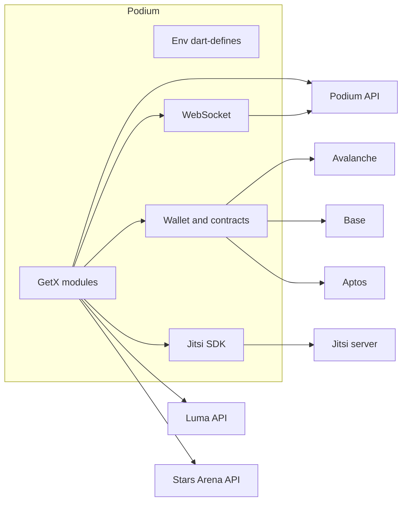

<p align="center">
  
</p>

<h1 align="center">Podium</h1>

<p align="center">
  Live audio and video rooms for web3 communities.<br />
  A Flutter app for iOS and Android.
</p>

<p align="center">
  
  
  
  
</p>

An **outpost** is a scheduled or live room. People join with a social login or a wallet, talk over [Jitsi](https://jitsi.org/), and can gate entry or the mic with on-chain passes. The interface is a dark navy canvas with drifting cyan, violet, and magenta light. That look is documented in [`docs/design-system.md`](docs/design-system.md).

---

## Contents

- [What you can do](#what-you-can-do)
- [Stack](#stack)
- [Architecture](#architecture)
- [Repository layout](#repository-layout)
- [Requirements](#requirements)
- [First run](#first-run)
- [Environment](#environment)
- [Run](#run)
- [Build](#build)
- [Code generation](#code-generation)
- [Tests](#tests)
- [Scripts](#scripts)
- [Troubleshooting](#troubleshooting)

---

## What you can do

### Sign in and onboarding

- Sign in with Web3Auth using X, Apple, Google, email, Facebook, LinkedIn, or GitHub. Each login comes with a built-in Podium wallet.
- Referral system: open a referral link or paste a referrer ID. The app shows who referred you, and tells you when that person has used up their invites.
- Pre-join access page. If you have no referral, connect an external wallet and buy a Podium Pass to get in.
- Restored sessions skip the login screen, and a branded launch loader shows while the app starts.
- An update prompt appears when the backend advertises a newer app version. Optional updates can be dismissed once per version.

### Discover

- Home greets you by time of day and lists your outposts, with shortcuts to explore or start one.
- The directory has a **Live now** rail, a **Live from people you follow** rail, a **Trending** rail with a time window toggle, and a full list of outposts.
- Tag pages (`#tag`) list every outpost that uses a tag.
- Search covers outposts, people, and tags in one place.
- Archived outposts can be shown or hidden from a profile setting.

### Create and schedule an outpost

- Set a name, a main subject, tags, and a cover image.
- Choose **who can join**: everyone, people who have the link, invited users, or ticket holders.
- Choose **who can speak**: everyone, invited users only, or ticket holders. Speaking rights are set separately from entry.
- Ticket gates accept Podium Passes, Stars Arena tickets (Avalanche), and Friend.tech keys (Base). You pick the sellers whose tickets count, by name, address, or Arena handle.
- Schedule for later or go live now. You can reschedule from the detail page.
- Publish a scheduled outpost as a Luma event, with Luma hosts and guests invited by email.
- Optional settings: 18+ content, recordable sessions, and cohosts who help run the room.

### Outpost page (before you join)

- Header with host, live and scheduled badges, recordable and 18+ flags, and who can join and speak.
- Copy the outpost link, or invite people to speak or to listen.
- Set a reminder through Podium notifications or your device calendar.
- See the Luma event's hosts and guests, with guest status (pending, approved, rejected), and share the Luma link.
- If you need a ticket, the ticket sheet lists the sellers, the price, what each ticket unlocks (enter, speak, or both), and whether you already hold it. You can buy in place.
- If the host has not joined yet, opening the outpost puts you on its waitlist until the host arrives.
- Hosts and cohosts get a link to that outpost's analytics.
- Links to a missing or removed outpost land on a "not found" page.

### Live room

- Audio over Jitsi. The mic button shows whether you are connecting, listening, or live. Voice levels show who is talking.
- **Talk time**: each speaker has a timer that runs only while unmuted. The header shows how much is left, or "unlimited" for the host.
- **Likes and dislikes** add seconds to a speaker's talk time or take seconds away.
- **Cheer and boo**: send an on-chain payment to a member. A cheer adds talk time and a boo removes it, in proportion to the amount (`MINIMUM_CHEERBOO_AMOUNT` and `CHEERBOO_TIME_MULTIPLICATION`). Cheering yourself buys more time, and the fee is shared with the other members.
- Emoji reactions float across the room.
- Raise or lower your hand. Hosts see raised hands and can lower them all at once.
- Room chat. Messages are visible to everyone and disappear when the outpost ends.
- Polls. The host starts a poll with a question and options, everyone votes once and can change their vote, and final results stay visible when the poll ends.
- Screen sharing on Android, and on iOS through a broadcast upload extension. Sharing your screen uses your talk time.
- People sheet with search by name or address, and filters for speakers, talking now, listeners, and raised hands.
- Member sheet with role, talk time left, and a link to the profile. Hosts can mute or remove a member, or lower their hand.
- Host tools: mute everyone, lower all hands, invite, copy link.
- A banner shows when someone is recording the room.
- Minimize the call into a floating bubble that stays on top while you use the rest of the app, with chat, open, and leave actions.
- In-app tutorial, a report form for the outpost, and a call quality rating after you leave.

### Replays and recordings

- Record an outpost when it is marked recordable. The replay captures the call audio as heard on your device, the screen share, and a timeline of what happened in the room: members, speakers, raised hands, chat, polls, and reactions.
- Recording saves progress every few seconds (`RECORDING_CHUNK_SECONDS`, default 5). If the app is killed mid-call, the replay is recovered up to the last save on the next launch.
- The replay player rebuilds the room around the audio: who was on stage and talking, the screen share, chat, and the poll at each moment. It has a seek bar with screen-share clip markers, skip back and forward 10 seconds, and playback speed control.
- Share a replay as a single `.podium` file. Opening a `.podium` file from another app (open with or share to) imports it into Podium.
- The Records page lists replays with their status (recording, saving, failed and retry, ready, recovered) and audio-only recordings.
- Audio recordings show a waveform, can be trimmed before you keep them, and can be shared or deleted.
- Everything stays on the device unless you share it.

### Host analytics

- A host dashboard across all your outposts: peak and unique listeners, listening time, listeners who stayed 10+ minutes, sessions, and earnings.
- Charts for daily listeners, retention (the share of visits that lasted past a given number of minutes), and earnings from cheers and boos after fees.
- **Best time to go live**: when your followers or listeners are usually around, in your local time.
- Outposts ranked by listeners in the selected period.
- Per-outpost analytics with a session history. Only the host and cohosts can see them.

### Profiles and social

- Your profile has your account, wallets, activity, and preferences.
- Other people's profiles show pass holders, followers, and following, plus cheers and boos sent and received. You can follow, unfollow, and buy or sell their Podium Pass.
- Connected accounts: link several sign-in methods to one Podium account, switch between them, and choose the primary. Some actions are limited to the primary account.
- Alerts for outpost invitations and new followers. Accept or reject invites, and mark alerts as read. Push notifications are delivered through OneSignal.
- Refer friends from your profile, with a count of the invites you have left.
- Delete your account, log out, or send a bug report or feedback.

### Wallets and chains

- Built-in Podium wallet from Web3Auth, with EVM and Movement addresses, balances (Base ETH, AVAX, MOVE), and private key export.
- External wallets through Reown AppKit (WalletConnect). Choose a default wallet, or forget it.
- Activate Friend.tech on your wallet so you can buy and use keys.
- On-chain integrations: FiHub on Avalanche and Aptos, Stars Arena on Avalanche, Friend.tech on Base, and cheer and boo contracts loaded from backend metadata.

### App experience

- Aurora design: a dark navy canvas with drifting cyan, violet, and magenta light, shared across pages so transitions stay smooth. Several color themes can be picked from the profile.
- Deep links: `podium://` and the HTTPS base in `BASE_DEEP_LINK_URL` open an outpost or a referral. If you are not logged in yet, the link waits until you are.
- Connectivity tracking that pauses while the app is in the background and resyncs when it comes back.
- Firebase Analytics and Firebase Storage for outpost images.

---

## Stack

| Area | Choice |
| --- | --- |
| UI | Flutter, Material, Sora |
| Navigation and state | GetX (`get`). A few widgets use `flutter_bloc`. |
| HTTP | Dio, with a debug logger |
| Realtime | WebSocket channel to the Podium backend, plus Jitsi for media |
| Auth | Web3Auth Flutter SDK |
| Wallets | Reown AppKit, `web3dart`, a forked Aptos client |
| Push | OneSignal |
| Analytics and files | Firebase Analytics, Firebase Storage |
| Models | `json_serializable`, `copy_with_extension` |
| Assets | `flutter_gen` |

Bundle id on both stores: `com.web3podium`. The iOS broadcast upload extension is `com.web3podium.broadcast`.

---

## Architecture

Feature code lives in `lib/app/modules/<feature>/` as a GetX page: a `Binding`, a controller, and a view. Shared session state (login, deep links, the wallet, the active call) sits on `GlobalController`, registered for the life of the process.



`lib/env.dart` reads every secret and endpoint with `String.fromEnvironment`. Nothing is loaded from a bundled `.env` at runtime. `Env.ensureConfigured()` throws before the first frame if a required key is empty.

API models mirror the backend’s snake_case fields. Generated `*.g.dart` files are checked in, and the analyzer ignores them.

---

## Repository layout

```
lib/
  main.dart                 App start, deep links, Web3Auth and Reown
  env.dart                  Compile-time configuration
  root.dart                 Shell: aurora background, navbar, call bubble
  app/
    routes/                 GetX route table
    modules/
      login/                Social login and referrals
      home/                 Home feed
      allOutposts/          Outpost directory
      createOutpost/        Create and schedule a room
      outpostDetail/        Room page before you join
      ongoingOutpostCall/   Live room
      search/  notifications/  myProfile/  profile/
      records/              On-device replays and recordings
      replay/               Replay player
      hostAnalytics/        Host dashboard and per-outpost analytics
      checkTicket/          Ticket gates
      global/               Shared controllers, chain clients, services
    services/replay/        Replay recording, processing, storage, sharing
  providers/api/            Dio clients: podium, luma, arena
  services/websocket/       Socket messages
  contracts/                ABIs and chain ids
  widgets/ui/               Aurora components
  data/repositories/        Session and user access
  gen/                      Generated assets, fonts, colors
env/
  .env.example              Template. Real files stay local.
jitsi-meet-flutter-sdk/     Forked Jitsi Flutter SDK (git submodule)
docs/design-system.md       Color, type, and motion for Aurora
```

Routes worth knowing:

| Path | Screen |
| --- | --- |
| `/login` | Sign in. This is the initial route. |
| `/home` | Home |
| `/all-outposts` | Directory |
| `/search` | Search |
| `/notifications` | Alerts |
| `/my-profile` | Your profile |
| `/create-outpost` | Create a room |
| `/outpost-detail` | Room detail |
| `/ongoing-outpost-call` | Live room |
| `/records` | Saved replays and recordings |
| `/replay` | Replay player |
| `/tag-outposts` | Outposts for one tag |
| `/profile` | Someone else's profile |
| `/connected-accounts` | Linked sign-in methods |
| `/host-dashboard` | Host analytics across your outposts |
| `/host-outpost-analytics` | Analytics for one outpost |
| `/referral` | Referral landing, opens the login page |

The bottom bar is Home, Outposts, Search, Alerts, Profile. It stays hidden until you are logged in.

---

## Requirements

- Flutter stable with Dart `>=3.4.3 <4.0.0`
- Xcode with CocoaPods, for iOS 16+
- Android Studio, JDK, and an Android SDK (min SDK 26)
- Firebase CLI and the FlutterFire CLI
- Git, with submodule support

---

## First run

### 1. Clone, including the Jitsi SDK

```bash
git clone --recurse-submodules <repository-url>
cd podium
```

If the repo is already cloned:

```bash
git submodule update --init --recursive
```

The submodule is [`jitsi-meet-flutter-sdk`](https://github.com/mhsnprvr/jitsi-meet-flutter-sdk), pinned in `.gitmodules`.

### 2. Point the Android Jitsi build at your checkout

`jitsi-meet-flutter-sdk/android/build.gradle` resolves native libraries from a local Maven repo. Update the `url` so it matches this machine:

```gradle
url "/absolute/path/to/podium/jitsi-meet-flutter-sdk/android/libs"
```

### 3. Install packages

```bash
flutter pub get
cd ios && pod install && cd ..
```

### 4. Configure Firebase

Firebase options and the platform config files are not in git.

```bash
dart pub global activate flutterfire_cli
flutterfire configure
```

### 5. Create the environment file

```bash
cp env/.env.example env/development.env
```

Fill in every value. See [Environment](#environment). Add `env/production.env` before you cut a release build. Both files are gitignored. Their values are compiled in with `--dart-define-from-file` and are not shipped as assets.

### 6. iOS Particle credentials

The Xcode project bundles `ios/Runner/ParticleNetwork-Info.plist`. Copy the example and fill in the Particle project id, client key, and app id:

```bash
cp ios/Runner/ParticleNetwork-Info.plist.example ios/Runner/ParticleNetwork-Info.plist
```

The filled-in plist is gitignored.

### 7. Launch

```bash
./runDebug.sh
```

That script writes the version from `pubspec.yaml` into `env/development.env`, then runs:

```bash
flutter run --dart-define-from-file=env/development.env
```

---

## Environment

`development` and `production` are the two files the editor launch configs use. A build script accepts any name, as long as `env/<name>.env` exists.

The app refuses to start when any of these are empty:

| Key | Used for |
| --- | --- |
| `ENVIRONMENT` | `development` or `production` |
| `PODIM_BACKEND_BASE_URL` | Podium HTTP API |
| `WEBSOCKET_ADDRESS` | Live room socket |
| `JITSI_SERVER_URL` | Media server |
| `BASE_DEEP_LINK_URL` | HTTPS links that open the app |
| `APP_STORE_URL` | Store link shown by the version checker |
| `WEB3_AUTH_CLIENT_ID` | Web3Auth |
| `PROJECT_ID` | Reown AppKit (WalletConnect) project id |
| `CHAIN_NAMESPACE` | Wallet namespace passed to Reown, such as `eip155` |
| `INITIAL_EXTERNAL_WALLET_CHAIN_ID` | Chain selected when an external wallet connects |
| `ONESIGNAL_API_KEY` | OneSignal app id |
| `LUMA_API_KEY` | Luma event import |
| `ALBY_API_KEY` | Alby |
| `FIHUB_ADDRESS_AVALANCHE_MAINNET` | FiHub on Avalanche (`43114`) |
| `FIHUB_ADDRESS_APTOS` | FiHub on Aptos |
| `STARS_ARENA_ADDRESS_AVALANCHE_MAINNET` | Stars Arena tickets |
| `STARS_ARENA_PROXY_ADDRESS_AVALANCHE_MAINNET` | Stars Arena proxy |
| `FRIENDTECH_ADDRESS_BASECHAIN_MAINNET` | Friend.tech keys on Base (`8453`) |
| `MINIMUM_CHEERBOO_AMOUNT` | Smallest cheer or boo |
| `CHEERBOO_TIME_MULTIPLICATION` | How long a reaction stays on screen |

`RECORDING_CHUNK_SECONDS` is optional and defaults to `5`. It sets how often a replay in progress is saved to disk.

`VERSION` is optional at compile time (it falls back to a default). `runDebug.sh`, `buildApk.sh`, `buildBundle.sh`, and `buildIpa.sh` overwrite it with the version in `pubspec.yaml` before each build.

`env/.env.example` also lists `CHEERBOO_ADDRESS_MOVEMENT_DEVNET`, `CHEERBOO_APTOS_ADDRESS`, and `PODIUM_PROTOCOL_APTOS_ADDRESS`. The running app loads those contract addresses from backend metadata, so they are not part of the startup check.

Keep real env files and the Particle plist on your machine. Do not commit them.

---

## Run

Editor configurations in `.vscode/launch.json`:

| Name | Mode | Environment file |
| --- | --- | --- |
| DEV | debug | `env/development.env` |
| DEV-PROD | debug | `env/production.env` |
| DEV-VERBOSE | debug, verbose logs | `env/development.env` |
| PROFILE | profile | `env/production.env` |
| RELEASE | release | `env/production.env` |

From a terminal, pass the file yourself. A run without it will stop in `Env.ensureConfigured()`.

```bash
flutter run --dart-define-from-file=env/development.env
```

---

## Build

Each script reads `version:` from `pubspec.yaml`, writes `VERSION=` into the env file, then builds. The default environment is `production`.

```bash
./buildApk.sh development          # release APK
./buildBundle.sh production        # Android App Bundle
./buildIpa.sh production           # iOS IPA
```

Release builds of the bundle and the IPA are obfuscated, with split debug info written to `./debug-info`. Archive that folder with the build if you need to symbolicate a crash.

`generate-key.sh` creates the Android release keystore expected by the Gradle signing config. Run it once per machine, and keep the keystore out of git.

`codemagic.yaml` is a starter iOS workflow. Fill in the App Store app id, signing, and publish targets before you rely on it.

---

## Code generation

Models and asset accessors are generated. After you change a `@JsonSerializable` class, a `copyWith` class, or a file under `assets/`:

```bash
./generate.sh
# dart run build_runner build
```

Icons and the native splash have their own scripts:

```bash
./generate\ icons.sh       # icons_launcher
./generateSplashScreen.sh  # flutter_native_splash
```

`changePackageName.sh` rewrites the application id to `com.web3podium`. You only need it if that id has drifted.

---

## Tests

```bash
flutter test
```

Coverage today is focused on ticket access, chain amounts, live member lists, palette smoke checks, and global services.

Static analysis:

```bash
flutter analyze
```

`analysis_options.yaml` enables the Flutter lints plus `prefer_const_constructors`. Generated files, `lib/customLibs/`, and the Jitsi submodule are excluded.

---

## Scripts

| Script | What it does |
| --- | --- |
| `runDebug.sh` | Stamp the version, run against `env/development.env` |
| `buildApk.sh [env]` | Release APK |
| `buildBundle.sh [env]` | Release App Bundle, obfuscated |
| `buildIpa.sh [env]` | Release IPA, obfuscated |
| `generate.sh` | `build_runner` |
| `generate icons.sh` | App icon set |
| `generateSplashScreen.sh` | Native splash |
| `generate-key.sh` | Android release keystore |
| `changePackageName.sh` | Set the application id |
| `check_elf_alignment.sh` | Check 16 KB ELF alignment of an APK or `.so` directory |

---

## Troubleshooting

**The app exits immediately with `Missing build configuration`.**
The launch command has no `--dart-define-from-file`, or a required key in that file is still empty. Copy `env/.env.example` and fill every key listed in the startup table.

**Android cannot resolve Jitsi artifacts.**
`jitsi-meet-flutter-sdk/android/build.gradle` still points at another machine. Set `url` to this checkout’s `jitsi-meet-flutter-sdk/android/libs`, then clean:

```bash
flutter clean && flutter pub get
```

**`jitsi-meet-flutter-sdk` is an empty directory.**
Initialize the submodule:

```bash
git submodule update --init --recursive
```

**iOS build cannot find `ParticleNetwork-Info.plist`.**
Copy `ios/Runner/ParticleNetwork-Info.plist.example` into place. The Xcode project references that file by name.

**Firebase configure looks stale.**

```bash
flutter clean
flutter pub get
flutterfire configure
cd ios && pod install && cd ..
```

**iOS signing fails.**
Open `ios/Runner.xcworkspace` in Xcode and select a team for the Runner target and the broadcast extension. CocoaPods should be current (`pod repo update` if the lockfile resolves but the sandbox does not).

**Android release signing fails.**
Generate the keystore with `generate-key.sh` and confirm `android/key.properties` points at it. That properties file stays local.
